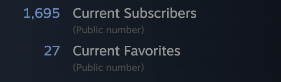

# ASCII Night Sky / ASCII-Solar-System

A procedurally generated, animated night sky made of ASCII characters, built as a live wallpaper for [Wallpaper Engine](https://store.steampowered.com/app/431960/Wallpaper_Engine/).

**[Steam Workshop](https://steamcommunity.com/sharedfiles/filedetails/?id=3422551960)** · **[Live demo](https://jacobsehl.com/ascii-solar-system/)**

## Traction



*1,695 current subscribers on Steam Workshop as of October 2026.*

## How it works

A wallpaper runs all day behind everything else, so the main design goal was to keep it light on CPU.

- **Procedural generation:** each page load picks a random seed for a simplex noise function. Stars are placed wherever the 2D noise value passes a threshold, which gives natural-looking clusters instead of uniform random scatter.
- **Twinkling:** each star samples 3D noise (x, y, time) to decide whether it shows as `*` or `.`. Time is quantized to 2 Hz, so the noise only gets recomputed twice a second instead of every frame.
- **Diff-based rendering:** the screen is a grid of character cells. Each frame compares the new state against the previous one and only updates the cells that actually changed, rather than redrawing the whole grid.
- **Frame-rate throttling:** the `requestAnimationFrame` loop is capped at 30 FPS, which is plenty for a slow ambient animation.
- **Resize handling:** the grid is rebuilt to fit the new window size, debounced by 250 ms so dragging a window doesn't trigger hundreds of rebuilds.

## Running locally

No build step or dependencies to install. Clone the repo and open `index.html` in a browser:

```bash
git clone https://github.com/Jacob-Sehl/ascii-solar-system.git
cd ascii-solar-system
```

To use it as a wallpaper, subscribe on the [Steam Workshop page](https://steamcommunity.com/sharedfiles/filedetails/?id=3422551960) with Wallpaper Engine installed.

## Configuration

These values are set at the top of `main.js`:

| Setting | What it controls |
| --- | --- |
| `charWidth`, `charHeight` | Size of each character cell in pixels |
| `targetFPS` | Frame-rate cap for the animation loop |
| `gameSpeed` | How fast time advances, which controls twinkle speed |

## Possible improvements

- Render to a single `<canvas>` instead of one DOM element per character cell, which would cut the DOM node count on large screens.

## License

[GPL-3.0](LICENSE)
